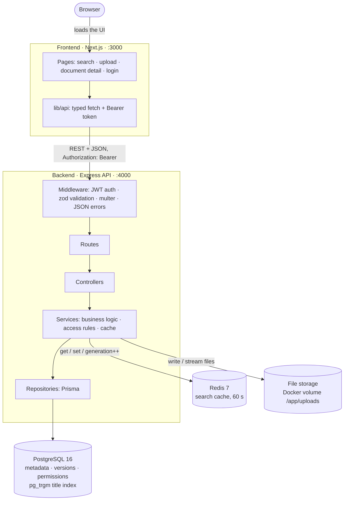

# Architecture

A Next.js frontend talks to an Express REST API, which stores metadata in PostgreSQL, caches searches in Redis and keeps files on a Docker volume. Everything runs with `docker compose up -d --build`.

For the tables, versioning and access rules, see [database.md](database.md).

## Diagram

A PNG version of the same diagram is in [architecture.png](architecture.png).

The browser loads the UI from Next.js and then calls the API directly. The API URL is baked into the frontend at build time, because the browser, not the frontend container, makes the calls.

## Request flows

### 1. Uploading a document (or a new version)

1. The upload form checks the file in the browser (allowed type, at most 20 MB, required fields) and sends `multipart/form-data` with the Bearer token.
2. **Middleware:** `requireAuth` verifies the JWT and loads the user. `multer` streams the file to a temp folder and rejects bad extension/MIME pairs (415) and files that are too large (413). zod validates the form fields (400).
3. **Service:** checks the file's first bytes against its extension (415 on mismatch) and resolves the owner department (the admin must choose one). It then moves the file to `uploads/<documentId>/v<n>-<uuid>.<ext>`; the client's filename is never used as a path.
4. **One database transaction:** create or find the tags, insert the document, its version, the tag links and the department permissions, then set `current_version_id`.
   - For a new version, the document row is locked (`SELECT … FOR UPDATE`) first, so concurrent uploads get distinct version numbers.
   - If the transaction fails, the stored file is deleted, so no orphan files are left.
5. The **search cache is invalidated** by incrementing the generation counter, and the API returns 201 with the document.

### 2. A search request with the Redis cache

1. `GET /api/documents?q=&tags=&uploaderId=&mine=&sort=&page=` is validated with zod (400 on bad parameters).
2. The cache key is `search:g<generation>:<userId>:<role>:<dept>:<sha1(normalized params)>`.
   - **HIT:** return the cached JSON with `X-Cache: HIT`.
   - **MISS:** build one Prisma query whose `WHERE` combines the access rules with the filters (title `ILIKE` uses the trigram index), run `count` and `findMany` in a single transaction, store the result for 60 s, and return it with `X-Cache: MISS`.
3. **Invalidation:** every upload, new version or soft delete runs `INCR search:generation`. All existing keys become unreachable at once (no key scanning) and expire through their TTL.
4. **Redis down:** commands fail fast (no offline queue, 500 ms timeout). The API logs one warning, answers from PostgreSQL (`MISS`) and reconnects in the background. On reconnect it bumps the generation, so results cached before the outage are never served.

## Design choices

| Choice | Reason |
|---|---|
| **Layered backend** (routes → controllers → services → repositories) | Each layer has one job: HTTP, orchestration, rules, data access. Easy to test and to change. |
| **REST + JSON** | Simple, cacheable, and maps directly onto the resources (documents, versions, files). |
| **zod validation** on every body, query and route id | The API never trusts the client; bad input is a clear 400 with per-field details. |
| **Consistent JSON errors** `{ error: { code, message, details? } }` | The frontend shows any error the same way (400, 401, 403, 404, 409, 413, 415). |
| **Prisma + PostgreSQL** | Type-safe queries and versioned migrations on a relational model with real foreign keys and constraints. |
| **UUID primary keys** | IDs are safe to expose in URLs and can't be enumerated. |
| **Versioning:** the document row holds the metadata, each version row is one immutable file, `current_version_id` points to the latest | A new upload never overwrites anything; the full history stays downloadable. |
| **Access model:** department visibility AND minimum role, with admin and uploader exceptions | Covers "restricted to departments" plus "managers only" with two small columns. |
| **Access rules enforced inside the SQL query** | Search totals and pagination only ever count documents the user may see. |
| **404 instead of 403** for documents the user can't see | Restricted documents don't reveal that they exist. |
| **pg_trgm GIN index** on `documents.title` (and `users.name`) | Fast case-insensitive *partial* matches (`ILIKE '%term%'`), which a B-tree can't serve. |
| **Indexes on searched/joined columns** (uploader, owner department, tag, `deleted_at`, `created_at`) | Filters, joins and sorting stay fast as data grows. |
| **Redis per-user cache with a generation counter** | Correct per user (results differ by access), and invalidating is one `INCR` with no key scanning. |
| **The app works if Redis is down** | The cache is an optimization, never a dependency. |
| **Soft delete** (`deleted_at`) | Deleted documents disappear from the app, but their rows and files stay for audit and recovery. |
| **Files on local disk / a Docker volume**, paths stored relative to the upload folder | Simple for a POC, and the storage root can move (e.g. to S3) without rewriting rows. |
| **Files served only with the Authorization header**; the frontend fetches blobs and shows them through `blob:` URLs | Tokens never appear in URLs, logs or browser history. |
| **JWT in localStorage** | Simple for a POC. HTTP-only cookies would be more secure against XSS (see the README's next steps). |

## How it would scale

- **Stateless API:** no sessions are kept in memory (JWT, Redis), so several API instances can run behind a load balancer.
- **Object storage:** move files from the volume to S3 or similar, with pre-signed or proxied downloads. Only the storage service changes.
- **Database:** add read replicas for search and detail reads, connection pooling (e.g. PgBouncer), and keep the trigram and foreign-key indexes as data grows.
- **CDN:** serve the frontend's static assets, and large files (through signed URLs), from a CDN close to users.
- **Search at larger scale:** move full-text and in-file search to a dedicated engine (e.g. OpenSearch) fed by upload events.
