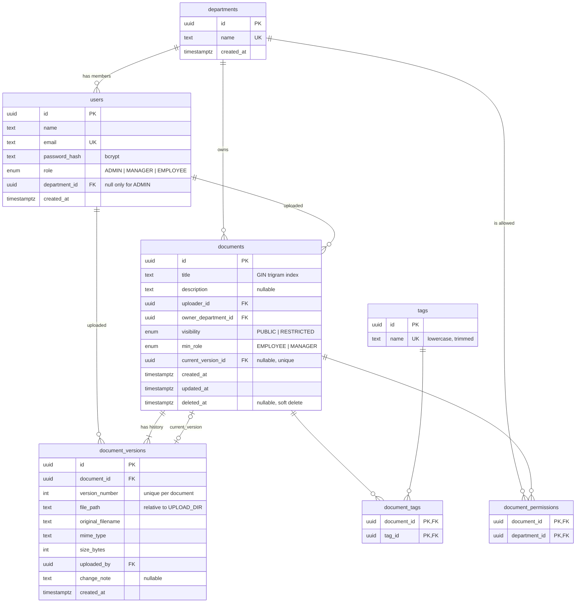

# Database design

PostgreSQL 16, managed with [Prisma](https://www.prisma.io/):

- Schema: [`backend/prisma/schema.prisma`](../backend/prisma/schema.prisma)
- Migrations: [`backend/prisma/migrations/`](../backend/prisma/migrations/)
- Seed: [`backend/prisma/seed.ts`](../backend/prisma/seed.ts)

All primary keys are UUIDs, so IDs are safe to expose in URLs and cannot be enumerated. Tables and columns use `snake_case`; the Prisma models map them to `camelCase` in code.

## ER diagram



## Tables

| Table | Purpose |
|---|---|
| `departments` | Organisational units: HR, Engineering, Legal, Finance. |
| `users` | Employees, with a bcrypt `password_hash`, a `role` and a department. Only an `ADMIN` may have no department, because admins are global; a CHECK constraint enforces this. |
| `documents` | The logical document and its metadata: title, description, owner department, visibility, minimum role, and a pointer to the current version. `deleted_at` marks a soft delete. |
| `document_versions` | One row per uploaded file: storage path, original filename, MIME type, size, uploader and an optional change note. |
| `tags` | Free-form tag names, unique and always stored lowercase and trimmed (CHECK constraint). A new tag is created the first time someone uploads with it. |
| `document_tags` | Many-to-many link between documents and tags (composite PK). |
| `document_permissions` | The departments allowed to view a `RESTRICTED` document (composite PK). |

## Versioning approach

The **document** row holds the metadata: title, description, tags and permissions. Each **version** row holds one immutable file.

- Uploading a new version **inserts** a `document_versions` row with `version_number = max + 1`, then points `documents.current_version_id` at it. Both happen in one transaction.
- Old version rows and their files are **never updated or deleted**, so the full history can still be listed and downloaded.
- `UNIQUE (document_id, version_number)` stops two concurrent uploads from claiming the same number.
- `current_version_id` is nullable because the document row has to exist before its first version can reference it. It is `UNIQUE`, since a version can be current for only one document.
- `file_path` is stored **relative to `UPLOAD_DIR`** (`<document_id>/v<n>-<uuid>.<ext>`, e.g. `…/v2-3f1c….pdf`; the client's filename is never used as a path and is kept only in `original_filename`). The storage root can then move, or later be swapped for object storage, without rewriting rows.
- Deleting a document is a **soft delete** (`deleted_at = now()`), so its versions are kept too. The `ON DELETE CASCADE` rules only apply if a document row is ever hard-deleted.

## Access rules

> The schema supports these rules; the API will enforce them in a later step.

### Viewing a document

A document is visible when **both** rules pass:

1. **Department rule:** `PUBLIC` means every department. `RESTRICTED` means only the departments in `document_permissions`, plus the owner department.
2. **Role rule:** `min_role = EMPLOYEE` means everyone. `min_role = MANAGER` means managers and the admin only.

**Exceptions:** the **admin** can always see everything, and the **uploader** can always see their own document. **Soft-deleted** documents (`deleted_at IS NOT NULL`) are hidden from everyone.

The same rules as a SQL predicate, for user `:uid` with `:role` and `:dept`:

```sql
d.deleted_at IS NULL
AND (
  :role = 'ADMIN'
  OR d.uploader_id = :uid
  OR (
    (   d.visibility = 'PUBLIC'
     OR d.owner_department_id = :dept
     OR EXISTS (SELECT 1 FROM document_permissions p
                WHERE p.document_id = d.id AND p.department_id = :dept))
    AND (d.min_role = 'EMPLOYEE' OR :role = 'MANAGER')
  )
)
```

### Uploading

| Action | ADMIN | MANAGER | EMPLOYEE |
|---|---|---|---|
| Upload a new document | ✅ chooses the owner department | ✅ owner department = their own | ✅ owner department = their own |
| Add a new version | ✅ any document | ✅ documents owned by their department | ✅ only documents they uploaded |
| View | everything | the rules above | the rules above |

### Who sees what with the seed data

This matrix was produced by running the predicate above against the seeded database.

| Document | Visibility / min role | admin | manager1 (HR) | manager2 (Eng) | employee1 (HR) | employee2 (Eng) | employee3 (Legal) | employee4 (Fin) |
|---|---|:-:|:-:|:-:|:-:|:-:|:-:|:-:|
| Company Code of Conduct | PUBLIC / EMPLOYEE | ✅ | ✅ | ✅ | ✅ | ✅ | ✅ | ✅ |
| Engineering Onboarding Guide | PUBLIC / EMPLOYEE | ✅ | ✅ | ✅ | ✅ | ✅ | ✅ | ✅ |
| Q3 Financial Report | RESTRICTED [Finance] / EMPLOYEE | ✅ | – | – | – | – | – | ✅ |
| Vendor Contract Template | RESTRICTED [Legal, Finance] / EMPLOYEE | ✅ | – | – | – | – | ✅ | ✅ |
| Salary Bands 2026 | RESTRICTED [HR] / MANAGER | ✅ | ✅ | – | – | – | – | – |
| System Architecture Overview | PUBLIC / MANAGER | ✅ | ✅ | ✅ | – | – | – | – |

Note that employee1 is in HR but can't see *Salary Bands 2026*: the department rule passes, but the role rule (`MANAGER`) fails.

## Indexes

| Index | Supports |
|---|---|
| `documents_title_trgm_idx`: GIN `gin_trgm_ops` on `documents.title` | Partial title search, `title ILIKE '%term%'` (a B-tree cannot serve a leading wildcard). |
| `users_name_trgm_idx`: GIN `gin_trgm_ops` on `users.name` | Search by uploader name. |
| `documents(uploader_id)`, `documents(owner_department_id)` | Filtering by uploader / department, FK joins, and the access check. |
| `documents(deleted_at)` | Excluding soft-deleted documents. |
| `documents(created_at)` | Sorting results newest first. |
| `tags_name_key`: unique on `tags.name` | Tag lookup by name (the unique constraint is the index). |
| `document_tags(tag_id)` | "Documents with tag X". The composite PK already covers lookups by `document_id`. |
| `document_versions_document_id_version_number_key` | Version history of a document. Its leftmost column is `document_id`, so it serves lookups by `document_id` and a separate index would be redundant. |
| `document_permissions(department_id)` | The `EXISTS` department check. |

The `pg_trgm` extension is enabled by hand-written SQL at the top of the init migration, before the trigram indexes are created. The trigram indexes are also declared in `schema.prisma`, so Prisma does not see them as drift and try to drop them in a later migration.

## Integrity rules

- **Foreign keys:**
  - `ON DELETE CASCADE` on `document_versions`, `document_tags` and `document_permissions`.
  - `ON DELETE RESTRICT` for uploaders, departments and owner departments, so history cannot be orphaned.
  - `current_version_id` uses `ON DELETE SET NULL`.
- **CHECK constraints** (hand-written in the init migration):
  - `users`: `role = 'ADMIN' OR department_id IS NOT NULL`
  - `tags`: `name = lower(btrim(name)) AND name <> ''`
  - `document_versions`: `version_number >= 1` and `size_bytes >= 0`

## Seed data

`npm run db:seed` (in `backend/`) wipes all tables and `UPLOAD_DIR`, then recreates everything below. It can be re-run at any time. Each version gets a small real file (PDF or TXT) in `UPLOAD_DIR`, so downloads work.

### Logins

All passwords are **`123456`** (stored as bcrypt hashes).

| Name | Email | Role | Department |
|---|---|---|---|
| admin | admin@gmail.com | ADMIN | none |
| manager1 | manager1@gmail.com | MANAGER | HR |
| manager2 | manager2@gmail.com | MANAGER | Engineering |
| employee1 | employee1@gmail.com | EMPLOYEE | HR |
| employee2 | employee2@gmail.com | EMPLOYEE | Engineering |
| employee3 | employee3@gmail.com | EMPLOYEE | Legal |
| employee4 | employee4@gmail.com | EMPLOYEE | Finance |

### Documents

| Document | Owner | Visibility | Min role | Tags | Versions |
|---|---|---|---|---|---|
| Company Code of Conduct | HR | PUBLIC | EMPLOYEE | policy, hr | 1 (manager1) |
| Engineering Onboarding Guide | Engineering | PUBLIC | EMPLOYEE | technical, onboarding | 3 (employee2, employee2, manager2) |
| Q3 Financial Report | Finance | RESTRICTED [Finance] | EMPLOYEE | finance, report | 1 (employee4) |
| Vendor Contract Template | Legal | RESTRICTED [Legal, Finance] | EMPLOYEE | legal, finance | 1 (employee3) |
| Salary Bands 2026 | HR | RESTRICTED [HR] | MANAGER | hr, finance, policy | 2 (manager1) |
| System Architecture Overview | Engineering | PUBLIC | MANAGER | technical | 1 (manager2) |

Tags: `policy`, `hr`, `finance`, `legal`, `report`, `technical`, `onboarding`.
